<div align="center">


# PharmaGest

**Application de bureau de gestion d'une pharmacie**

Mini-projet universitaire · Java Swing · JDBC · MySQL · Méthode MERISE

[](https://github.com/sharaf-naai/pharmagest/releases/latest)


[**⬇ Télécharger pour Windows**](https://github.com/sharaf-naai/pharmagest/releases/latest) · [Dossier MERISE (PDF)](docs/Dossier-MERISE-PharmaGest.pdf) · [Installation](#5-installation-version-windows)

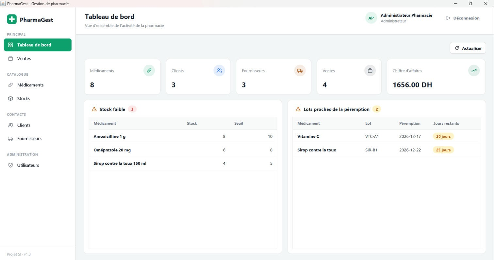

</div>

---

## Sommaire

1. [Présentation du projet](#1-présentation-du-projet)
2. [Fonctionnalités](#2-fonctionnalités)
3. [Captures d'écran](#3-captures-décran)
4. [Conception MERISE](#4-conception-merise)
5. [Installation (version Windows)](#5-installation-version-windows)
6. [Compiler depuis les sources](#6-compiler-depuis-les-sources)
7. [Architecture technique](#7-architecture-technique)
8. [Structure du dépôt](#8-structure-du-dépôt)
9. [Auteur](#9-auteur)

---

## 1. Présentation du projet

PharmaGest est une application de bureau qui gère l'activité quotidienne d'une pharmacie : catalogue des médicaments, clients, fournisseurs, ventes au comptoir, approvisionnements et suivi du stock.

Le projet a été réalisé en deux parties, comme demandé par le sujet :

| Partie | Contenu | Barème |
| --- | --- | :---: |
| **Analyse et conception** | Méthode MERISE : besoins, dictionnaire des données, MCD, MCT, MLD, MOT | 12 pts |
| **Implémentation** | Application Java Swing + JDBC + MySQL | 8 pts |

**Contraintes techniques respectées :** programmation orientée objet, interfaces Swing, gestion des événements, connexion MySQL avec JDBC, requêtes `PreparedStatement` uniquement, gestion des exceptions, code organisé en plusieurs classes et paquetages.

### Livrables

| Livrable | Où le trouver |
| --- | --- |
| Dossier d'analyse et de conception MERISE | [`docs/Dossier-MERISE-PharmaGest.pdf`](docs/Dossier-MERISE-PharmaGest.pdf) (21 pages) |
| Script SQL de création de la base | [`sql/pharmacie.sql`](sql/pharmacie.sql) |
| Code source complet | [`src/`](src/) |
| Application fonctionnelle | [Release Windows](https://github.com/sharaf-naai/pharmagest/releases/latest) (`PharmaGest.exe`) |
| Rapport et démonstration | Ce document + les captures ci-dessous |

---

## 2. Fonctionnalités

Les éléments marqués ★ sont des **ajouts** au cahier des charges.

| Module | Ce que l'application permet de faire |
| --- | --- |
| **Authentification** | Connexion par login et mot de passe, déconnexion · ★ mots de passe hachés (SHA-256) · ★ deux rôles (Administrateur, Pharmacien) · ★ comptes désactivables |
| **Médicaments** | Ajouter, modifier, supprimer · rechercher par nom ou par numéro · afficher la liste, le prix et la quantité disponible · ★ classement par catégorie |
| **Fournisseurs** | Ajouter, modifier, supprimer, rechercher, afficher la liste |
| **Clients** | Ajouter, modifier, supprimer, rechercher, afficher la liste |
| **Ventes** | Créer une vente, choisir un ou plusieurs médicaments, saisir les quantités · **total calculé automatiquement** · enregistrer, consulter l'historique et le détail d'une vente · ★ client « de passage » |
| **Stocks** | Consulter les quantités · enregistrer un approvisionnement auprès d'un fournisseur · **stock augmenté à la réception, diminué après une vente** · signalement des médicaments sous le seuil minimal · ★ n° de lot et date de péremption · ★ alerte des lots qui expirent dans 30 jours |
| **Tableau de bord** | Nombre de médicaments, de clients, de fournisseurs, de ventes · chiffre d'affaires · liste des médicaments en stock faible · ★ lots proches de la péremption |
| ★ **Utilisateurs** | Créer un compte, changer son rôle, l'activer ou le désactiver, réinitialiser son mot de passe |

### Les deux rôles

| | Administrateur | Pharmacien |
| --- | :---: | :---: |
| Tableau de bord (chiffre d'affaires) | ✔ | — |
| Ventes | ✔ | ✔ |
| Médicaments | ✔ modification | ✔ lecture seule |
| Stocks et approvisionnements | ✔ | ✔ lecture seule |
| Clients | ✔ | ✔ |
| Fournisseurs | ✔ | — |
| Utilisateurs | ✔ | — |

### Quelques règles de gestion appliquées

Le dossier MERISE en définit 28 (RG01 à RG28). Elles sont contrôlées dans le code, et chaque contrôle porte son numéro en commentaire (`// RG17`).

| Règle | Ce qui se passe dans l'application |
| --- | --- |
| **RG04** | Un compte désactivé ne peut pas se connecter. |
| **RG09** | Un médicament déjà vendu ou livré ne peut pas être supprimé. |
| **RG17** | On ne peut pas vendre plus que la quantité en stock. |
| **RG18** | Le prix enregistré dans une vente est celui de la base au moment de la vente, pas celui affiché à l'écran. |
| **RG20** | Vente, lignes et baisse du stock sont enregistrées dans **une seule transaction** : tout réussit ou tout est annulé. |
| **RG24** | Stock faible = quantité inférieure au seuil minimal du médicament. |

---

## 3. Captures d'écran

> Captures prises sur l'application réelle avec les données de démonstration du script SQL.

### Connexion

<table>
<tr>
<td width="65%">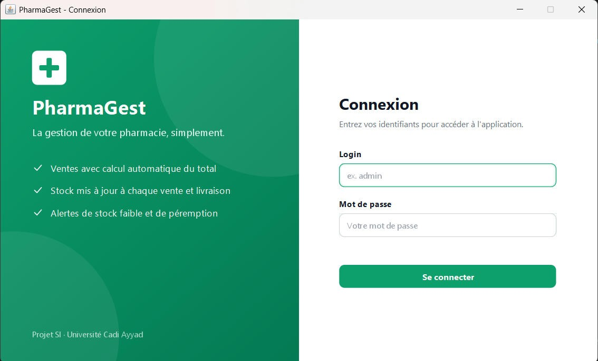</td>
<td width="35%">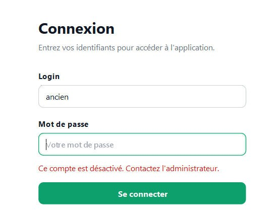<br><sub><b>RG04</b> : le compte <code>ancien</code> est désactivé, la connexion est refusée avec un message clair.</sub></td>
</tr>
</table>

### Tableau de bord

Les indicateurs sont recalculés à chaque ouverture de la page. À gauche, l'état initial ; à droite, après une vente de 80 DH et une livraison d'Amoxicilline et d'Oméprazole : 5 ventes, chiffre d'affaires de 1 736 DH, plus qu'un seul médicament en stock faible.

<table>
<tr>
<td></td>
<td>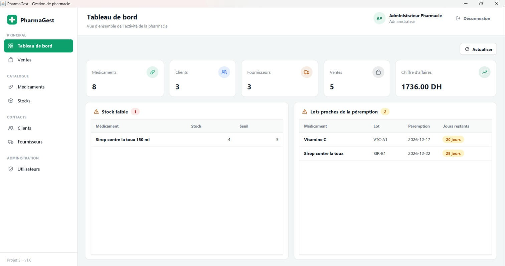</td>
</tr>
</table>

### Ventes

**1. Créer une vente.** On choisit le client (ou « client de passage »), puis chaque médicament avec sa quantité. Le total se met à jour à chaque ligne.

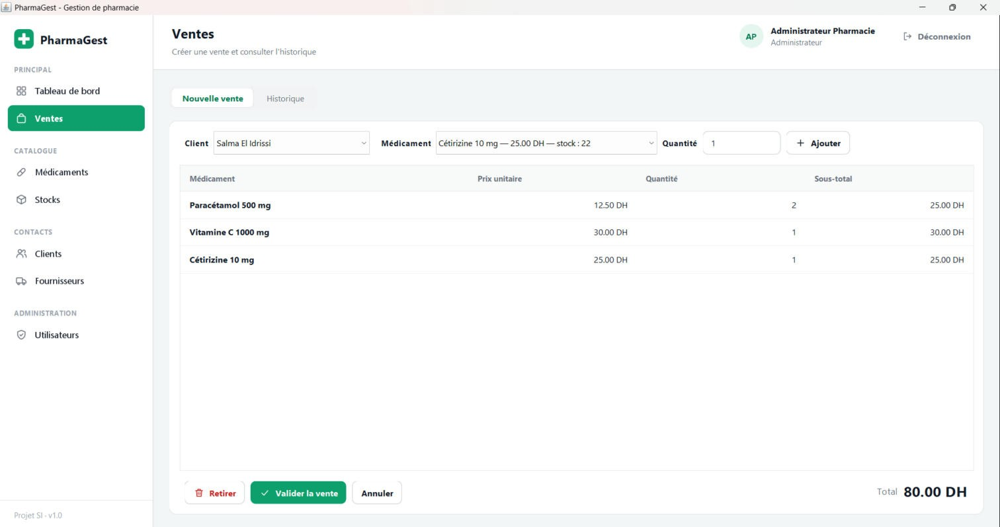

La liste des médicaments affiche le prix et le stock disponible :

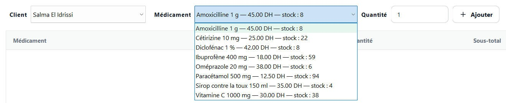

**2. Contrôles et validation.**

<table>
<tr>
<td>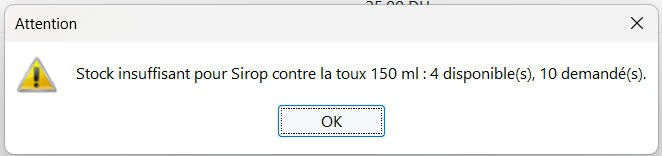<br><sub><b>RG17</b> : 10 sirops demandés, 4 en stock → refusé.</sub></td>
<td>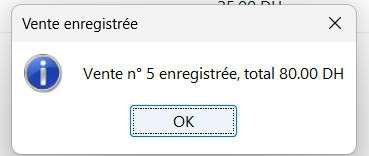<br><sub>Après confirmation, la vente est enregistrée et le stock diminue.</sub></td>
</tr>
</table>

**3. Historique.** Toutes les ventes, la plus récente en premier ; un clic affiche le détail.

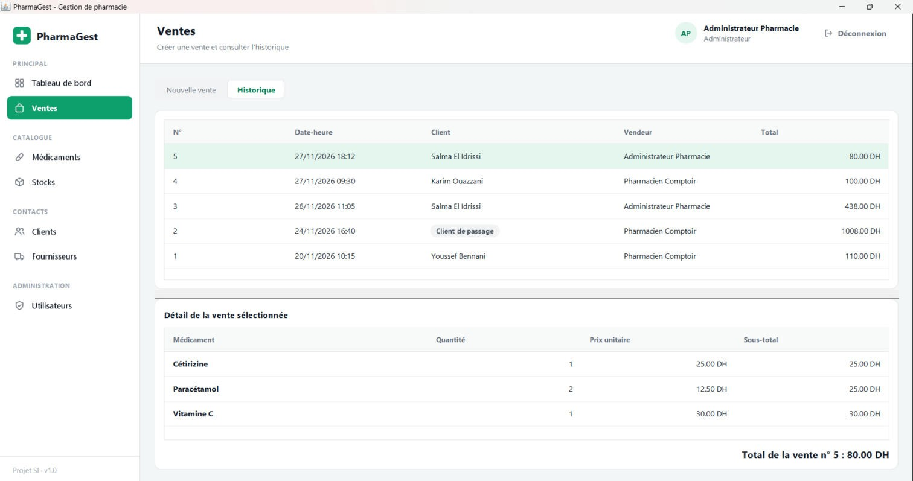

### Médicaments

Recherche par nom ou par numéro, fiche à droite. Le stock est en lecture seule : il ne change que par les ventes et les approvisionnements.

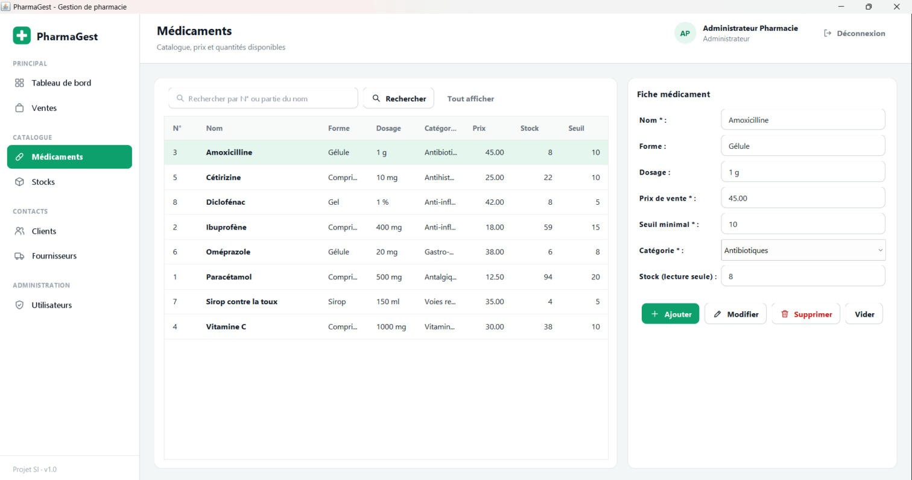

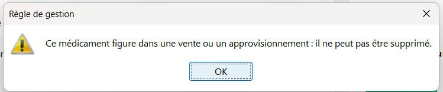<br>
<sub><b>RG09</b> : l'Amoxicilline figure déjà dans une vente, la base refuse sa suppression.</sub>

### Stocks

<table>
<tr>
<td>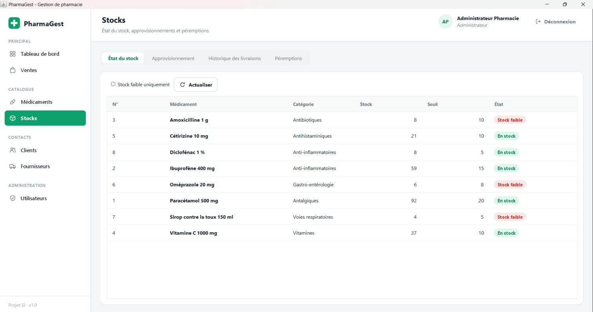<br><sub><b>État du stock</b> : badge rouge sous le seuil minimal (RG24). Le stock reflète la vente de 80 DH (Paracétamol 94 → 92).</sub></td>
<td>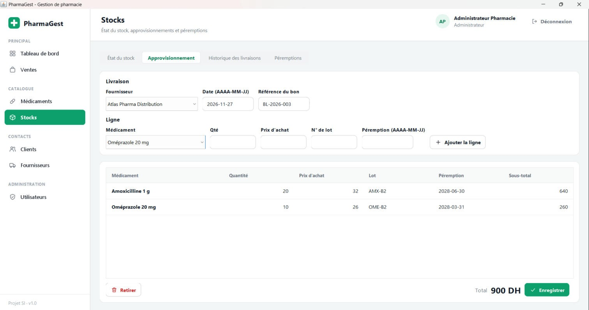<br><sub><b>Approvisionnement</b> : fournisseur, bon de livraison, et pour chaque médicament : quantité, prix d'achat, ★ lot et ★ date de péremption.</sub></td>
</tr>
<tr>
<td>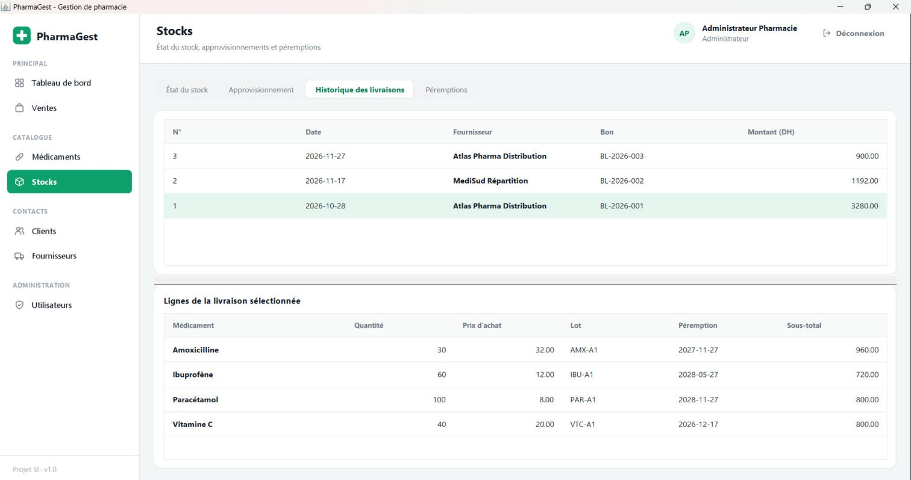<br><sub><b>Historique des livraisons</b> avec le détail des lots reçus.</sub></td>
<td>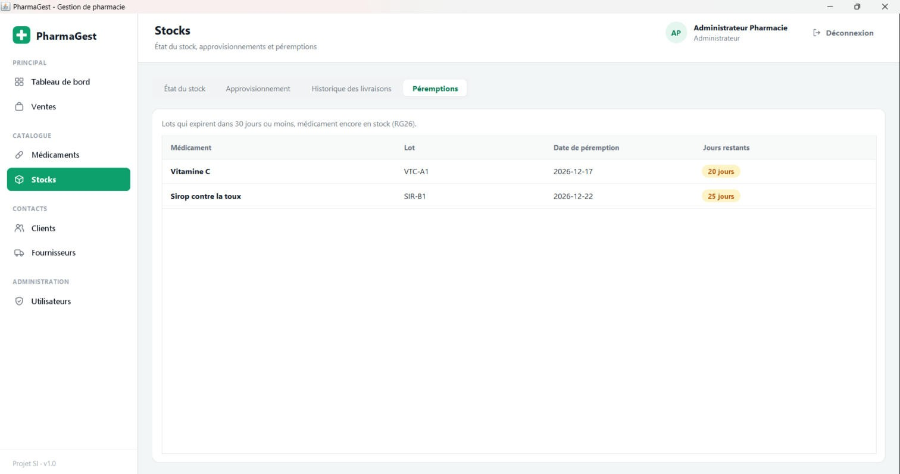<br><sub>★ <b>Péremptions</b> : lots qui expirent dans 30 jours ou moins (RG26).</sub></td>
</tr>
</table>

### Clients, fournisseurs et utilisateurs

<table>
<tr>
<td>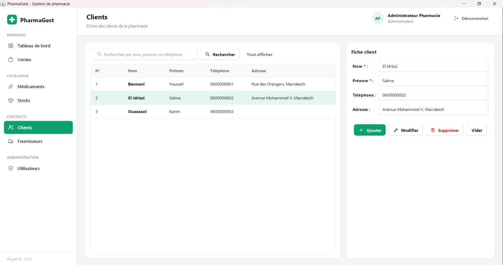<br><sub><b>Clients</b></sub></td>
<td>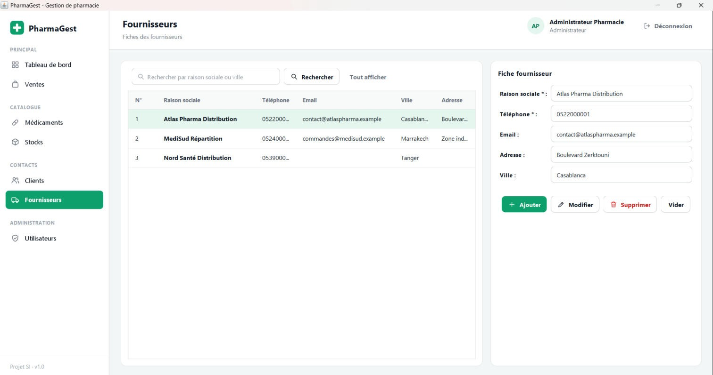<br><sub><b>Fournisseurs</b></sub></td>
</tr>
<tr>
<td>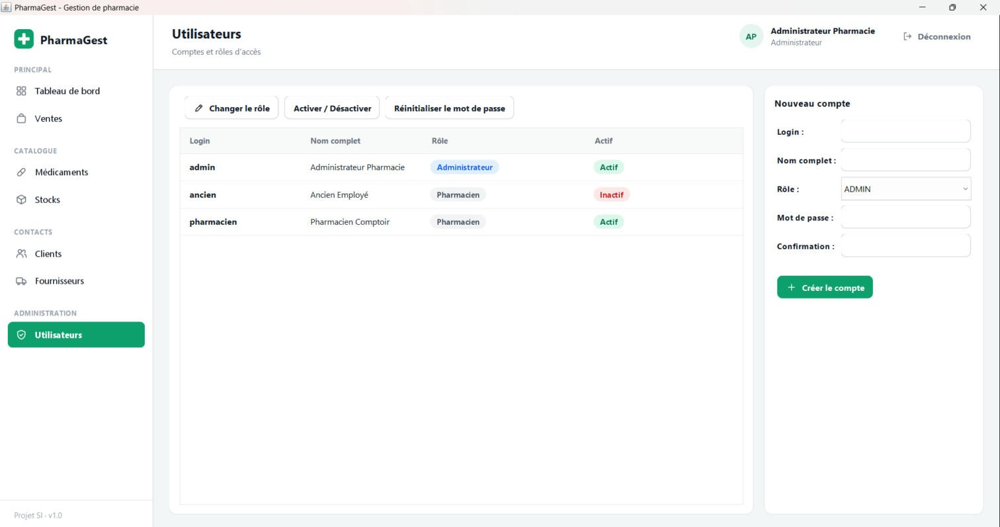<br><sub>★ <b>Utilisateurs</b> : rôles et comptes actifs ou désactivés.</sub></td>
<td>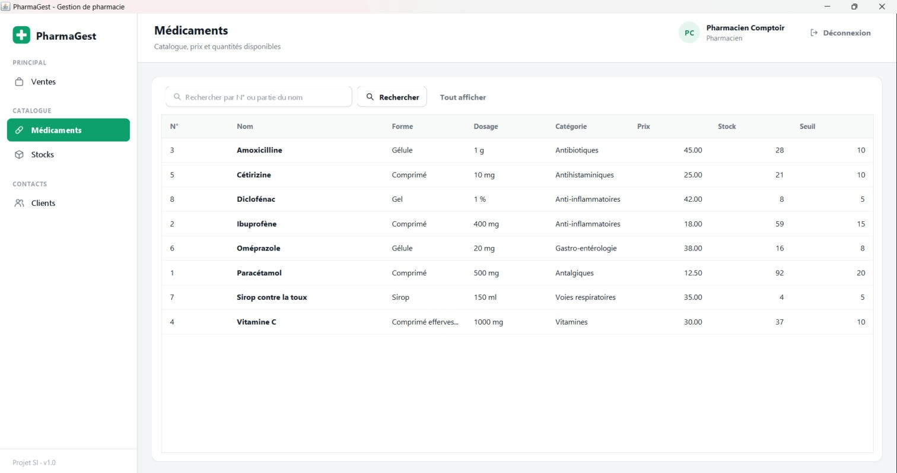<br><sub><b>Vue du pharmacien</b> : 4 pages seulement, médicaments en lecture seule (RG03).</sub></td>
</tr>
</table>

### Le code

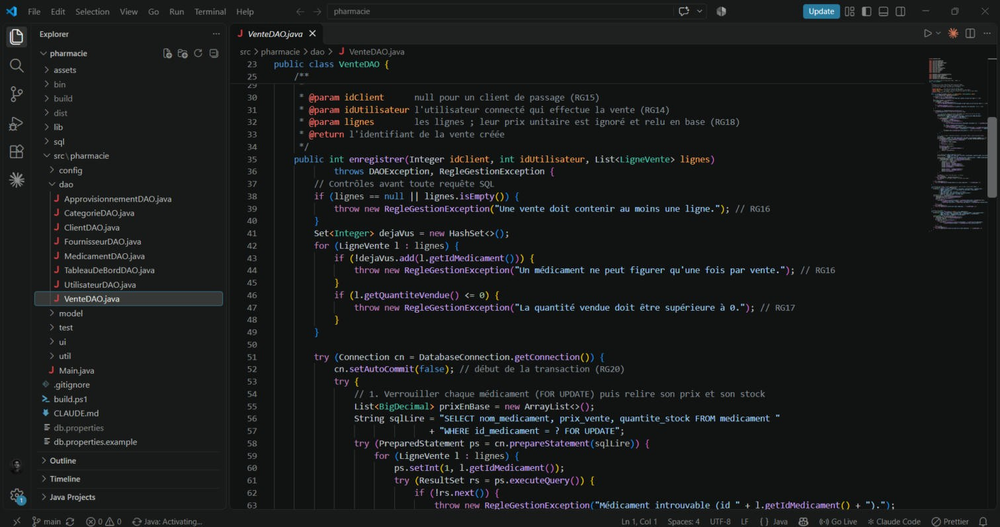
<sub><code>VenteDAO.enregistrer</code> : contrôles des règles de gestion avant toute requête, puis début de la transaction (RG20).</sub>

---

## 4. Conception MERISE

Le dossier complet est dans [`docs/Dossier-MERISE-PharmaGest.pdf`](docs/Dossier-MERISE-PharmaGest.pdf) : analyse des besoins (acteurs, fonctionnalités, 28 règles de gestion), dictionnaire des données (40 propriétés), MCD, MCT (9 opérations), MLD et MOT.

### Modèle Conceptuel des Données (MCD)

7 entités et 7 associations. Le médicament est au centre : il sort du stock par **CONTENIR** (ventes) et y entre par **COMPORTER** (approvisionnements).

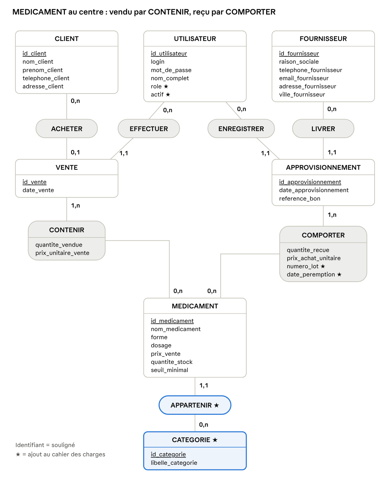

### Modèle Logique des Données (MLD)

Clé primaire en **gras**, clé étrangère précédée de `#`.

- UTILISATEUR (**id_utilisateur**, login, mot_de_passe, nom_complet, role, actif)
- CATEGORIE (**id_categorie**, libelle_categorie)
- MEDICAMENT (**id_medicament**, nom_medicament, forme, dosage, prix_vente, quantite_stock, seuil_minimal, #id_categorie)
- CLIENT (**id_client**, nom_client, prenom_client, telephone_client, adresse_client)
- FOURNISSEUR (**id_fournisseur**, raison_sociale, telephone_fournisseur, email_fournisseur, adresse_fournisseur, ville_fournisseur)
- VENTE (**id_vente**, date_vente, #id_client, #id_utilisateur)
- LIGNE_VENTE (**#id_vente, #id_medicament**, quantite_vendue, prix_unitaire_vente)
- APPROVISIONNEMENT (**id_approvisionnement**, date_approvisionnement, reference_bon, #id_fournisseur, #id_utilisateur)
- LIGNE_APPROVISIONNEMENT (**#id_approvisionnement, #id_medicament**, quantite_recue, prix_achat_unitaire, numero_lot, date_peremption)

### Modèle Conceptuel des Traitements (MCT) : la vente

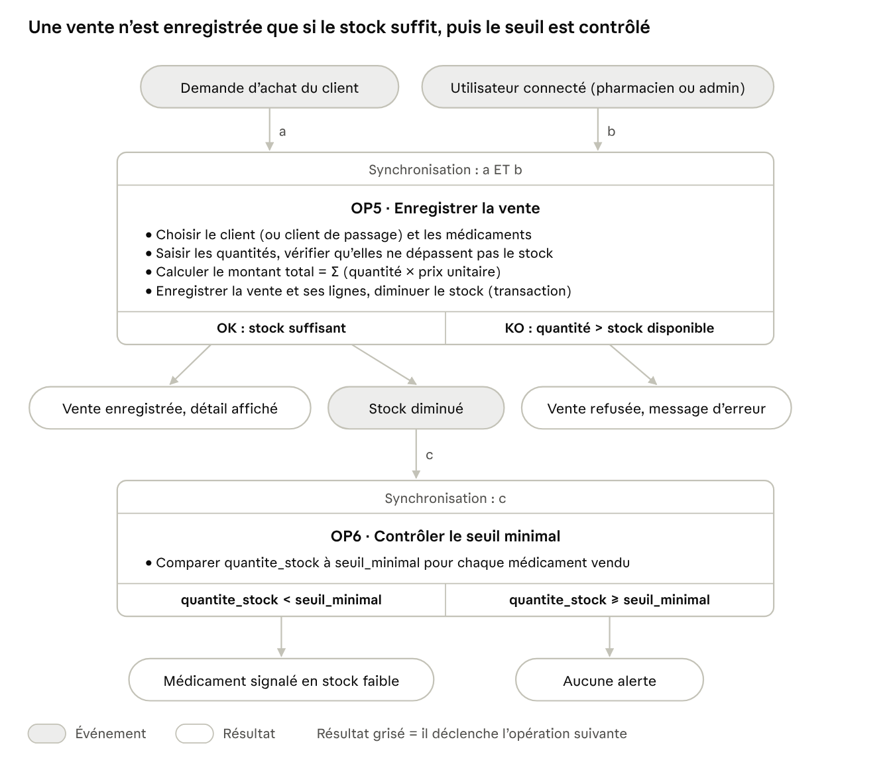

<details>
<summary>Voir les autres MCT (authentification, tableau de bord)</summary>
<br>
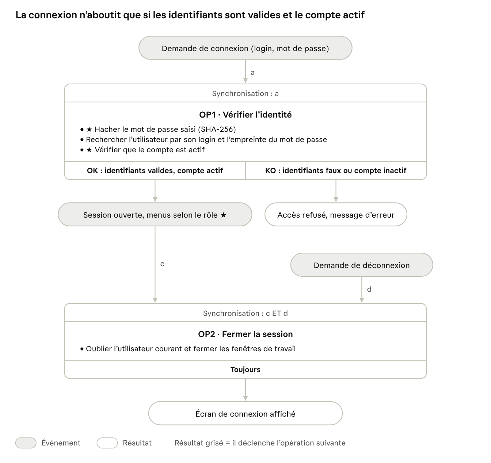
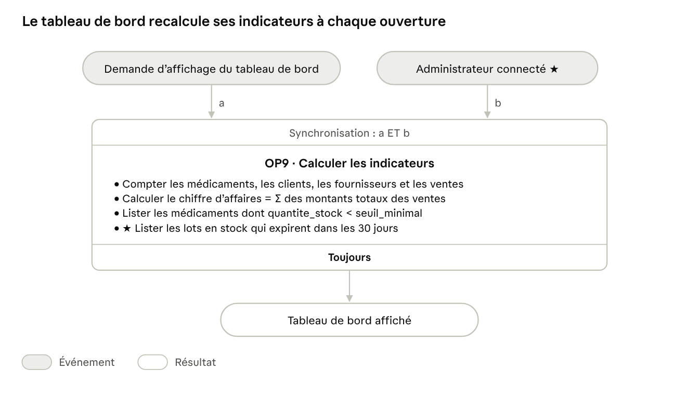
</details>

### Modèle Organisationnel des Traitements (MOT) : la vente au comptoir

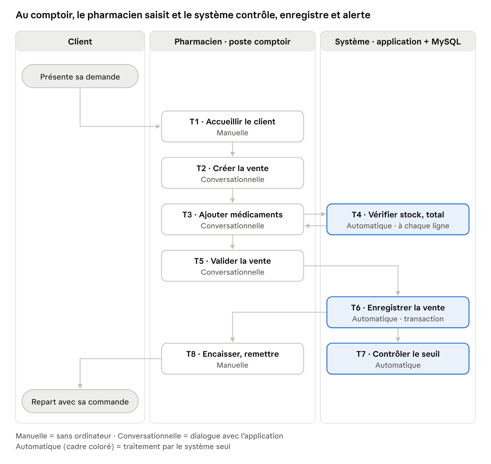

---

## 5. Installation (version Windows)

Pas besoin d'installer Java : il est inclus dans l'application.

### Prérequis

- Windows 10 ou 11 (64 bits)
- **MySQL Server 8.0.16 ou plus récent** ([télécharger](https://dev.mysql.com/downloads/installer/)). Pendant l'installation, choisissez un mot de passe pour l'utilisateur `root` et notez-le.

### Étapes

**1. Télécharger** `PharmaGest-1.0.0-windows.zip` depuis la page [Releases](https://github.com/sharaf-naai/pharmagest/releases/latest), puis l'extraire (clic droit → *Extraire tout…*). On obtient un dossier `PharmaGest`.

**2. Créer la base de données** avec le fichier `pharmacie.sql` fourni dans ce dossier, au choix :
- avec **MySQL Workbench** : *File → Open SQL Script…* → `pharmacie.sql` → bouton ⚡ ;
- ou en ligne de commande, depuis le dossier `PharmaGest` :
  ```powershell
  mysql -u root -p --default-character-set=utf8mb4 -e "source pharmacie.sql"
  ```

**3. Configurer la connexion** : copier `db.properties.example` en `db.properties` (dans le même dossier), l'ouvrir avec le Bloc-notes et remplacer `CHANGE_ME` par votre mot de passe MySQL :
```properties
db.url=jdbc:mysql://localhost:3306/pharmacie?useSSL=false&allowPublicKeyRetrieval=true&characterEncoding=UTF-8
db.user=root
db.password=votre_mot_de_passe
```

**4. Lancer** `PharmaGest.exe`.

> **Windows affiche « Windows a protégé votre ordinateur » ?** C'est normal pour une application non signée : cliquez sur **Informations complémentaires → Exécuter quand même**.
>
> **Windows bloque complètement le fichier (« Smart App Control ») ?** Lancez l'application avec le Java signé fourni, depuis le dossier `PharmaGest` :
> ```powershell
> .\runtime\bin\javaw.exe -jar .\app\pharmagest.jar
> ```

**5. Se connecter** avec un compte de démonstration :

| Login | Mot de passe | Rôle |
| --- | --- | --- |
| `admin` | `admin123` | Administrateur (accès complet) |
| `pharmacien` | `pharma123` | Pharmacien (accès limité) |
| `ancien` | `ancien123` | Compte désactivé (pour tester le refus de connexion) |

Pour revenir aux données de démonstration d'origine, il suffit de rejouer l'étape 2.

### Dépannage

| Message | Cause et solution |
| --- | --- |
| *Fichier db.properties introuvable* | Le fichier n'est pas à côté de `PharmaGest.exe`, ou il s'appelle encore `db.properties.example`. |
| *Connexion à MySQL impossible : Communications link failure* | MySQL n'est pas démarré. Ouvrez *Services* Windows et démarrez le service **MySQL80** ou **MySQL84**. |
| *Access denied for user 'root'* | Mot de passe incorrect dans `db.properties`. |
| *Unknown database 'pharmacie'* | L'étape 2 n'a pas été faite. |

---

## 6. Compiler depuis les sources

Prérequis : **JDK 17 ou plus récent** (testé avec JDK 27) et MySQL 8.

```powershell
git clone https://github.com/sharaf-naai/pharmagest.git
cd pharmagest

# Base de données + configuration
mysql -u root -p --default-character-set=utf8mb4 -e "source sql/pharmacie.sql"
Copy-Item db.properties.example db.properties   # puis mettre votre mot de passe dedans

# Compiler et lancer
javac -encoding UTF-8 -d bin -cp "lib/*" (Get-ChildItem -Recurse src -Filter *.java).FullName
java -cp "bin;lib/*" pharmacie.Main

# Tests automatiques (42 vérifications sur la vraie base, qui nettoient leurs données)
java -cp "bin;lib/*" pharmacie.test.TestPhase2

# Produire PharmaGest.exe et le zip à publier
powershell -ExecutionPolicy Bypass -File build.ps1
```

Le projet s'ouvre aussi directement dans **VS Code** (Extension Pack for Java) : le pilote MySQL dans `lib/` est détecté automatiquement.

---

## 7. Architecture technique

L'application est organisée en couches : les écrans ne parlent jamais directement à la base, ils passent par les DAO.

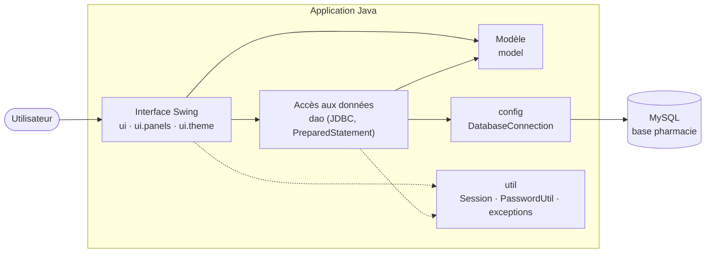

| Couche | Paquetage | Rôle |
| --- | --- | --- |
| Interface | `pharmacie.ui`, `ui.panels`, `ui.theme` | Fenêtres Swing, une page par module, composants graphiques réutilisables |
| Accès aux données | `pharmacie.dao` | Une classe DAO par table, toutes les requêtes en `PreparedStatement` |
| Modèle | `pharmacie.model` | Une classe par table (Medicament, Vente, LigneVente…) |
| Configuration | `pharmacie.config` | Ouverture des connexions JDBC à partir de `db.properties` |
| Utilitaires | `pharmacie.util` | Session, hachage SHA-256, `DAOException` et `RegleGestionException` |

**Points techniques :**
- **Transactions JDBC** : la vente et l'approvisionnement utilisent `setAutoCommit(false)`, verrouillent les lignes de stock avec `SELECT … FOR UPDATE`, puis font `commit()`, ou `rollback()` en cas d'erreur.
- **Deux types d'exceptions** : `RegleGestionException` pour une règle de gestion non respectée (message affiché à l'utilisateur), `DAOException` pour une erreur technique (connexion, SQL).
- **Vues SQL** pour les données calculées : `v_vente_total`, `v_stock_faible`, `v_peremption_proche`, `v_tableau_de_bord`.
- **Contraintes en base** : clés étrangères (`RESTRICT`, `SET NULL`, `CASCADE`), contraintes `CHECK` sur les prix et les quantités, `UNIQUE` sur les logins.
- **Interface 100 % Swing**, sans bibliothèque externe : thème, icônes et composants sont dessinés en Java2D (`ui.theme`).

---

## 8. Structure du dépôt

```
pharmagest/
├── src/pharmacie/
│   ├── Main.java            point d'entrée
│   ├── config/              connexion JDBC
│   ├── dao/                 accès aux données (8 DAO)
│   ├── model/               classes métier
│   ├── ui/                  fenêtres, menu, bandeau
│   │   ├── panels/          une page par module
│   │   └── theme/           charte graphique et composants
│   ├── util/                session, hachage, exceptions
│   └── test/                TestPhase2 (tests sur la base)
├── sql/pharmacie.sql        création de la base + données de démonstration
├── lib/                     pilote MySQL Connector/J
├── docs/                    dossier MERISE (PDF), captures, diagrammes
├── assets/                  icône de l'application
├── build.ps1                construction de PharmaGest.exe
└── db.properties.example    modèle de configuration
```

---

## 9. Auteur

Réalisé par **Sharaf N.** ([@sharaf-naai](https://github.com/sharaf-naai)) · Sciences Informatiques, Université Cadi Ayyad.

Projet académique, réalisé dans un but pédagogique. Les données de démonstration (clients, fournisseurs, médicaments) sont fictives.
